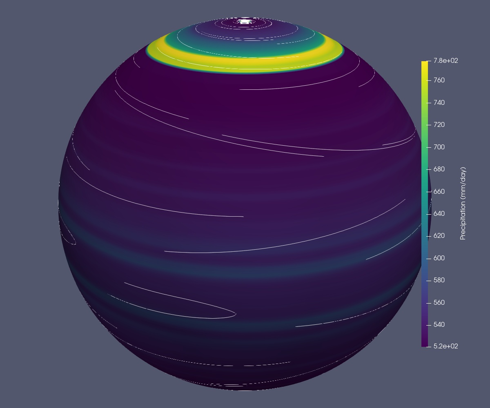

# ATHAD_COND

**The Hadean atmosphere after condensation.**

<p align="center"></p>

<p align="center"><sub>Precipitation (mm/day) at the surface of the CO₂ atmosphere over the hot sea, 520–778 mm/day in bands; white: surface-wind stream lines; north pole at the top. Arm <code>run_long_tied</code> (Tiedtke convection) at iteration 400, drawn from the level-0 radial slice with <code>literature/hadean_globe.py</code> (outside the repo).</sub></p>

**The Hadean family.** Three successive epochs of the early Earth, one model each, forked from one another with their full history so fixes cherry-pick in both directions:

| Model | Epoch | Atmosphere | Surface |
|---|---|---|---|
| [ATHAD](https://github.com/RogerGrundmann/ATHAD) | ~4.4 Ga, over the magma ocean | steam (H₂O-dominated), ~250 bar | molten or quenching rock, no topography |
| **ATHAD_COND** (this repo) | after the steam rained out | CO₂-dominated, 27–100 bar | liquid sea at 230–250 °C |
| [ATHAD_PERID](https://github.com/RogerGrundmann/ATHAD_PERID) | after a peridotitic magma ocean solidified | CO₂-dominated, 5–20 bar | ocean at 20–150 °C |

**Sister family:** the same ATOM numerics run the giant planets -- [ATJUP](https://github.com/RogerGrundmann/ATJUP), [ATSAT](https://github.com/RogerGrundmann/ATSAT), [ATURAN](https://github.com/RogerGrundmann/ATURAN), [ATNEPT](https://github.com/RogerGrundmann/ATNEPT).

An atmospheric general-circulation model of the epoch that follows
[ATHAD](https://github.com/RogerGrundmann/ATHAD): the magma ocean has quenched, the steam
atmosphere has rained out into a liquid ocean, and what remains above it is a
CO₂-dominated atmosphere of **27–100 bar over a 230–250 °C sea**. Same solver — a
finite-difference Navier–Stokes solver on a spherical shell with RK4 time integration and
vertical coordinate stretching — applied to the opposite thermodynamic regime.

ATHAD_COND is forked from ATHAD at `29ca2f9`, **carrying its full history**, so fixes
cherry-pick in both directions. ATHAD in turn is the atmosphere half of
[ATOM_Precipitation](https://github.com/RogerGrundmann/ATOM_Precipitation) (forked at
`1e3f319`).

**Where it differs from ATHAD, in one sentence:** ATHAD's water is supercritical from the
ground to ~177 km and *nothing condenses*; here water is subcritical everywhere and
condensation is live from the sea surface up, so the code paths ATHAD spent seventeen
defect-fixes making inert are the ones this model depends on.

## The convection scheme is a moist convective adjustment since 2026-10-10 — the Tiedtke scheme is no longer called

`ATM_CONV_SCHEME=<adjust|tiedtke>`, default `adjust`, at the user's instruction ("replace the Tiedtke scheme with a simple moist convective adjustment").

The full text is in [CLAUDE.md](CLAUDE.md).


## Three instruments from upstream, and what they read on their first call (2026-10-10)

`ATM_SATADJ_DIAG`, `ATM_MC_DIAG` and `ATM_MC_CAP_DIAG`, all print-only and default off, ported from `ATOM_Precipitation` (`03c8451`, `11ec280`, and `15fd99a` / `e8d06ce` / `f6f5642`), where between 2026-08-31 and 2026-09-24 they attributed that tree's moist-physics defects one by one.

The full text is in [CLAUDE.md](CLAUDE.md).


## The background opacity, split per species — a no-op that stopped being one

Ported from ATHAD (its README item 60), where `kappa_bg` = 1e-6 m2/kg — the value of a radiatively inert diatomic — was being applied to a background containing NH3 and CH4 at 1.4 mole-% each, and splitting it raised the effective background opacity 1867x.

The full text is in [CLAUDE.md](CLAUDE.md).


## The sweep count: p_dyn's amplitude and Psi are DECOUPLED, and the 28 % was the initial projection

The first version of this section attributed a 28 % drop in `Psi_max` to the time-loop solve.

The full text is in [CLAUDE.md](CLAUDE.md).


## The CO2 distribution work ported from ATHAD (its README items 56-57, 59)

This fork had already found half of it, and the half it found was the right half. `ThermoAtm::co2Atmosphere()` did not fill a uniform mass fraction.

The full text is in [CLAUDE.md](CLAUDE.md).


## Repository layout

```
atmosphere/   C++ source — the atmosphere model
cli/          Command-line interface source and config file
lib/          Array classes, config reader, shared utilities
python/       Cython bindings, run scripts, output directory
test/         Standalone self-tests
tinyxml2/     Vendored XML parser
```

## Build, run, test

```bash
make cond                                       # -> cli/cond
make test                                       # self-tests, run these first
cd python && OMP_NUM_THREADS=8 ../cli/cond config_cond.xml
```

Output lands in `python/output_Hadean_condensation/`.

`make` regenerates the parameter bindings from `param.py` first. The generated files are
tracked on purpose, so a `param.py` change shows its full effect in the diff.

## Conditions

The stated inputs are **T = 230–250 °C, p = 27–100 bar, H₂O 0.4–2 %, CO₂ 89–95 %,
N₂ 5–20 % by mole**. The nominal run point is the midpoint, **60 bar / 513.15 K**.

**The stated composition and the stated temperature describe different heights, and this
is the single most important thing to understand about the configuration.** The quoted
0.4–2 % H₂O is the *dry* atmosphere, what survives above the cold trap. Air in contact
with a 240 °C sea holds water at its own vapour pressure: `p_sat(513.15 K) = 33.47 bar` of
a 60 bar column, so `x_H₂O = 0.5578` at the surface — fifty-five times the dry figure. Both
are true, at different heights, and the column runs between them.

**Since 2026-08-20 the five trace gases carry ATHAD's mole fractions** — CH₄, NH₃, H₂, CO
and SO₂ at 0.014 each — where they used to be zero. `x_H₂O` is fixed by the sea and cannot
give way, so they displace CO₂ and N₂ within the 44.22 % that is not water; above the cold
trap they are **15.7 % of the dry atmosphere and CO₂ falls to 77.4 %, below the quoted
89–95 %**. That is a deliberate departure from the stated composition. Note also that
matching ATHAD's *fractions* does not match its *amounts*: 1.4 % of ATHAD's 250 bar is
3.5 bar per gas, 1.4 % of this 60 bar column is 0.84 bar, so the same numbers imply four
fifths of each trace gas left with the water.

| | at the sea | above the cold trap |
|---|---|---|
| x = (H₂O, CO₂, N₂) | .5578 / .3459 / .0263 | .010 / .7744 / .0589 |
| x(CH₄, NH₃, H₂, CO, SO₂) | .014 each | .0313 each |
| M_mean [g/mol] | 27.79 | 39.90 |
| R_mix [J/(kg·K)] | 299.2 | 208.4 |
| cp [J/(kg·K)] | 1372.6 | 1042.5 † |

† **The 1042.5 is the dry composition at the SEA-SURFACE temperature**, not at the cold
trap. `cp_of(dry, 513.15 K)` = 1042.5; at cold-trap conditions it is **886.4** (the
Shomate fits clamp below 298 K). This table warns two paragraphs above that the stated
composition and the stated temperature describe different heights — and then does it
itself, for this one entry. The 1372.6 is sound: it is `cp_of` at the sea, and it is what
`cp_l` is set to.

| q_H₂O [kg/kg] | 0.3616 | 0.00452 |
| ρ [kg/m³] | 39.08 | — |
| scale height | 15.7 km | 10.9 km |

The background is no longer N₂ alone: M_bg = 26.138 g/mol, **R_bg = 318.10 J/(kg·K)**
(was 296.8), within 0.3 % of ATHAD's 317.26 because in both forks the traces are ~71 % of
the background by mass. `M_nonwater` at the sea is **40.12 g/mol** (was 42.88). And the
background's grey opacity Σf_i·κ_i goes **1e-6 → 1.944e-3 m²/kg**, so item 60's per-species
split — an exact no-op at the old composition — now carries NH₃ (48.7 %), SO₂ (36.7 %) and
CH₄ (13.8 %).

Water boils at 548.7 K at 60 bar, so the sea is 35 K below boiling. (At the 27 bar end of
the stated range water boils at 501.2 K, so a 503 K surface there has **no liquid ocean at
all** — that corner is not a colder version of this one, it is a different model.)

`test/cond_column_selftest.cpp` asserts every number in that table, plus the arithmetic
connecting the config to it. The config's `x_*` and `r_air` are derived quantities; change
one without the other and the test fails, which is the point.

## Four invariants — do not silently break these

1. **There is no topography, and the planet is hemispherically symmetric.** `h ≡ 0`,
   `i_topography ≡ 0` everywhere, so `AtomUtils::is_land()` is false at every point — now a
   global *ocean* rather than a global magma surface, but the same statement in code.
   `LandOceanFraction()` throws if a land point ever appears. Any north–south asymmetry in
   the output is a defect: the surface temperature is a symmetric parabola, the insolation
   is mirrored, and there is no obliquity and no seasonal cycle.

2. **Water is subcritical everywhere, and condensation is live.** *This is ATHAD's
   invariant 2, inverted.* Critical point 647.096 K / 220.64 bar; this column runs
   511 K / 60 bar downward, so every condensation path is a path that runs. What carries
   over unchanged is *which formulas are allowed*: **never reintroduce Magnus** (calibrated
   to ~320 K, returns 1.2e7 hPa at 513 K) and **never the dilute `q_sat = ep·E/(p−E)`**.
   The dilute form is invalid here for the opposite reason it was invalid in ATHAD — water
   is 0.4 % by mole above the cold trap, where it would be fine, and 56 % at the sea, where
   it is not. A form valid over part of the column is worse than one valid over none,
   because it looks right in the printouts.

3. **Radiation runs in mode 2** (direct σT⁴). Modes 0/1/3/4/5 lean on the Scotese snapshot
   or the 280 ppm CO₂ reference; neither exists in a 92 % CO₂ atmosphere at 4.4 Ga.

4. **The column is on its own adiabat, integrated not fitted — and the adiabat is MOIST
   where the air is saturated.** `SaturationH2O::moistLapse`, hydrostatic on the layer-mean
   T, isothermal above `t_skin`. Do **not** restore the COSMO `T = T₀√(1−coeff·h)` form, and
   do **not** revert to the dry adiabat: `cosmo_lapse_fraction = 1.0` is justified in ATHAD
   *because nothing condenses there*, and that justification is void here.

## What the model currently says

Everything below is measured. Items refer to the commits.

**1. The moist adiabat, and the number that nearly went in wrong.** The saturated lapse
rate is

    dT/dz = −g·[1 + L·A/(R_mix·T)] / [cp + L²·A/(R_v·T²)],   A = x·Mw·Mo/den²

and the familiar `g/(cp + L·dq_sat/dT)` is only its denominator. That truncation gives
**0.7 K/km** at this sea surface; the full expression gives **5.04 K/km** against a dry
7.27. A factor of seven, and the truncated form is the one that looks like the textbook.
The neglected term is the pressure dependence of `q_sat`, negligible for a trace gas and
not for 56 % water. Checked against Earth at 300 K / 1 bar, where it returns 3.81 K/km.

**2. `dq_sat/dT` was the dilute limit.** `q_sat·L/(R_v·T²)` is the `x → 0` form; the exact
mass-fraction derivative is larger by `M_other/(x·Mw + (1−x)·Mo)` = **1.478** at the sea
surface. This fed the saturation adjustment's Newton damping `ω = 1/(1+Gain)`, so the
damping was a third too weak in exactly the high-`q_sat` regime it exists for.

**3. The initial state is a fixed point of three fields, and iterating it does not
converge.** `c` depends on T and p, `co2` depends on `c`, and T and p depend on both.
Iterating them closes a loop over the runaway-greenhouse feedback: 3 passes gave 446.7 K at
8.9 km, 8 passes gave 463.8 K, still climbing. That is the correct physics arriving through
the wrong numerics. `densities(true)` integrates the water profile in the same upward sweep
as T and p — one pass, exact.

**4. The measured column.** A saturated troposphere **62 km deep**: 511 K at the sea, 487 K
at 4.5 km, 429 K at 18 km, 367 K at 34 km, 280 K at 60 km, with the first 10 km at
**5.02 K/km** against the 5.04 predicted. `q_H₂O` tracks `q_sat` to four digits throughout.
Precipitable water **133.5 m**.

**5. The cold trap is eight times too wet.** It sits at the inherited `t_skin` and 0.02 bar
and passes **0.0349 kg/kg** of water, against the **0.00423** the stated dry composition
implies. The stated "H₂O 0.4–2 % by mole" and the stated 230–250 °C sea are mutually
consistent only if the cold trap is near **217 K**, which is what `p_sat/p = 0.0099` at
0.02 bar requires. So `c_h2o_dry_top` is currently a floor the column never reaches.

**6. The OLR is not yet an output.** At 20 iterations:

```
mean planetary albedo    = 0.4997        absorbed SW + geothermal = 120.84 + 150.00 = 270.84 W/m2
outgoing long wave (OLR) = 268.10 W/m2   imbalance                = 2.74 W/m2
lid temperature / eps    = 262.22 K / 0.0000
sigma*T_lid^4            = 268.10 W/m2
```

**OLR and σT_lid⁴ are equal to six figures.** This is exactly the condition ATHAD's item 10
diagnosed and the diagnostic was built to flag. The cause here is different from ATHAD's,
though: the lid is genuinely transparent (eps = 0.0000) and the shell is deep enough. The
grey optical depth reaches 1 at ~0.07 bar, which is *where the isothermal skin begins*, so
the emission to space comes from a layer whose temperature is prescribed — and `t_skin` is
a fixed point relaxing to close the very balance being reported. The balance closes to
2.74 W/m² because it was constructed to.

Deepening the shell will not fix this. It is the isothermal-skin prescription that has to
go, which is the same open task as ATHAD's invariant 3.

## Assumptions vs. results — read this before quoting any number

| Parameter | Value | Status |
|---|---|---|
| `geothermal_flux` | 150 W/m² | **Inherited from ATHAD's magma ocean and almost certainly wrong here.** It is 55 % of the entire energy input, against modern Earth's 0.087 W/m². A quenched surface under a liquid ocean does not deliver this. **Biggest unexamined input.** |
| `kappa_H2O` / `kappa_CO2` / `kappa_bg` | 0.01 / 0.001 / 1e-6 m²/kg | Factor-of-2 uncertain. `kappa_CO2` now dominates: the CO₂ column is 5.8e5 kg/m² against water's 2.6e3 |
| `t_surf_equator` / `t_surf_pole` | 513.15 / 503.15 K | **Prescribed, not solved.** The 10 K contrast is an assumption |
| `t_skin` | fixed-point iterate | Currently *sets* the OLR — see item 6 |
| `albedo_cloud` | 0.50 | IS the model's planetary albedo (0.4997 measured); saturates the moment condensate exists, and condensate is now everywhere |
| insolation | 0.71 S₀ | Faint young Sun |
| `omega` | 3.17e-4 (5.5 h day) | Inherited from ATHAD; a post-condensation Earth is later and slower |
| `delta_i_c` | 500 s over ocean | Bechtold's convective adjustment timescale, Earth-calibrated. A time, not a pressure — no unit error to correct, and no evidence here to replace it |
| Shomate `cp` below 298 K | clamped | The cold trap and skin sit below the fit range |

A grey scheme cannot represent the window regions that set the real runaway limit.

## The pattern this fork was expected to bring, and did

ATHAD's README records seventeen defects of one shape:

The full text is in [CLAUDE.md](CLAUDE.md).


## Reproducibility

Run-to-run bit-identical at a fixed thread count; thread-count dependent at ~1e-8. Measured at 24 threads, three one-iteration runs identical in every number, and at 20 iterations 24 threads against 8 agree in every wind extremum and differ in the last digit of `residuum_atm` (0.77593489 against 0.77593490).

The full text is in [CLAUDE.md](CLAUDE.md).


## What the surface state still breaks — audit, 2026-08-18 (items 1-3 RETRACTED same day)

The surface moved from ATHAD's 250 bar / 1500 K / supercritical to 60 bar / 513.15 K / subcritical.

The full text is in [CLAUDE.md](CLAUDE.md).


## Remaining work

WHY Psi DOES NOT CLOSE AT THE GROUND, AND THE TROPOPAUSE CONSTANTS THAT CAUSE IT (2026-08-24).

The full text is in [CLAUDE.md](CLAUDE.md).

